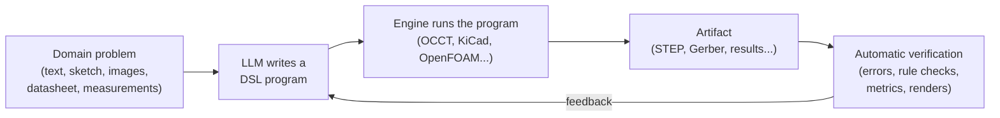
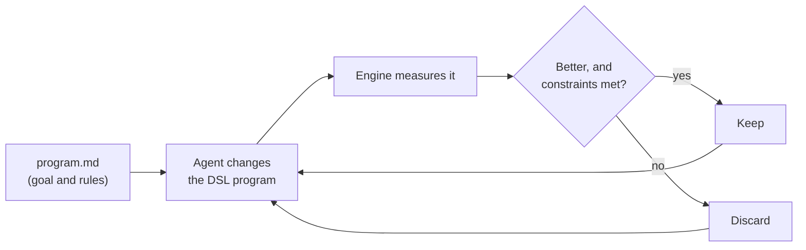

# Map to Software

> **Turn non-software problems into software problems, then let AI solve the software.**

Large Language Models (LLMs) keep getting better at writing code. On many programming tasks they already perform at the level of strong human engineers, and they keep improving. **Map to Software** starts from one working assumption:

> *Writing software is becoming a solved problem.*

If that holds, any problem that can be **expressed as code** can be handed to an AI that writes code. The question then changes from *"is there an AI for this domain?"* to *"what is the right language to express this domain as code?"*. And when the result can be measured, the AI can go further and **keep improving it on its own** (see [The improvement loop](#the-improvement-loop)).

This repository answers that question, domain by domain: **which language to use, which engine turns the code into the real result, and which benchmark shows how well AI models handle it**. It covers engineering (mechanical parts, circuit boards, chips, simulations, buildings, robots) and science (mathematics, laboratory work, optimization).

**Scope: science and engineering.** The goal is progress in understanding and building the physical world. A domain belongs here if solving it as code helps us **learn about nature or build better things**: parts, machines, chips, experiments, proofs. Domains about media, business or society (video, music, documents, finance, law) are out of scope: automating them does not move science forward.

---

## Domains

### Engineering and the physical world

| Domain | Recommended DSL | Engine / output | Best model now (leaderboard) | Guide |
|---|---|---|---|---|
| **Computer-Aided Design (CAD)** | CadQuery / build123d (Python) | OCCT → STEP, STL | [BenchCAD](https://benchcad.com/leaderboard) | [computer-aided-design.md](domains/computer-aided-design.md) |
| **Printed Circuit Board (PCB) Design** | Zener (Starlark) | `pcb` + KiCad → Gerber | None public yet | [printed-circuit-board-design.md](domains/printed-circuit-board-design.md) |
| **Digital Hardware Design (Chips and FPGAs)** | SystemVerilog / Verilog | Verilator, Yosys, OpenROAD → bitstream, GDSII | [HWE Bench](https://hwebench.com/v2.html) · [TuRTLe](https://huggingface.co/spaces/HPAI-BSC/TuRTLe-Leaderboard) | [digital-hardware-design.md](domains/digital-hardware-design.md) |
| **Engineering Simulation (FEA and CFD)** | CalculiX · FEniCSx · OpenFOAM (depends on the physics) | Solver → stresses, flows | None public yet | [engineering-simulation.md](domains/engineering-simulation.md) |
| **Architecture and Building Information Modeling (BIM)** | IfcOpenShell (Python) | Bonsai → IFC | None public yet | [architecture-and-bim.md](domains/architecture-and-bim.md) |
| **Robotics** | URDF / MJCF + ROS 2 (Python) | MuJoCo, Gazebo → real robot | None public yet | [robotics.md](domains/robotics.md) |

### Science and mathematics

| Domain | Recommended DSL | Engine / output | Best model now (leaderboard) | Guide |
|---|---|---|---|---|
| **Mathematics (Formal Proofs)** | Lean 4 + Mathlib | Lean kernel → checked proof | [PutnamBench](https://trishullab.github.io/PutnamBench/leaderboard.html) | [mathematics.md](domains/mathematics.md) |
| **Laboratory Automation and Life Sciences** | Opentrons Python Protocol API · RDKit | Simulator → lab robot | [LABBench2](https://benchlm.ai/benchmarks/labbench2) · [ChemBench](https://huggingface.co/spaces/jablonkagroup/ChemBench-Leaderboard) | [laboratory-automation.md](domains/laboratory-automation.md) |
| **Mathematical Optimization (Planning, Scheduling and Logistics)** | Pyomo · OR-Tools (Python) | HiGHS, CP-SAT, Gurobi → optimal plan | [LLM4OR](https://llm4or.github.io/LLM4OR/) | [mathematical-optimization.md](domains/mathematical-optimization.md) |

The **Best model now** column links straight to the live leaderboard where you can see which model is leading today. *None public yet* means the domain has benchmarks but no maintained leaderboard; the guide links the latest published results instead.

Each guide explains the recommended tool and why, the alternatives and when to use them, and the benchmarks for that domain.

*OCCT = Open CASCADE Technology, the open-source geometry kernel. STEP / STL = standard 3D model formats. Gerber = the standard format for manufacturing circuit boards. GDSII = the standard format for chip layouts. IFC = the open standard for building models.*

---

## The idea

### Reduction: borrowing a concept from computer science

In computational complexity theory, a [**reduction**](https://en.wikipedia.org/wiki/Reduction_(complexity)) turns every instance of a problem **A** into an instance of a problem **B**. Once you have that, any solver for B also solves A.

Map to Software applies the same idea:

| | Complexity theory | Map to Software |
|---|---|---|
| **Problem A** | The problem we want to solve | A real-world task: design a bracket, lay out a circuit board, prove a theorem |
| **Problem B** | A problem we already know how to solve | Writing a program in a domain-specific language (DSL) |
| **Solver for B** | An existing algorithm | An LLM that writes code, plus tools that run and check it |
| **The reduction** | A transformation from A to B | Describing the task in the DSL: *"design this bracket"* becomes *"write the CadQuery program that builds this bracket"* |

The consequence is what makes the idea powerful: if the DSL can express the useful designs of a domain, and running the program produces the real result (a manufacturable part, a board ready for fabrication, a verified proof), then **every improvement in AI coding carries over to that domain**. We do not need a separate "AI for CAD" or "AI for electronics". We need a good language for each domain and a good coding model.

### The bridge: Domain-Specific Languages (DSLs)

A [**Domain-Specific Language**](https://en.wikipedia.org/wiki/Domain-specific_language) is a programming language, or a library inside a general-purpose language, made for one field. In this project the DSL is what makes the reduction possible. A good DSL for this purpose is:

- **Text-based.** LLMs read and write text. A design stored as text can be generated, read, reviewed and edited by a model.
- **Executable and deterministic.** Running the same program always produces the same artifact (a 3D solid, a board layout, a simulation result).
- **Verifiable.** The output can be checked automatically: it runs without errors, passes design-rule checks, matches a reference, has the right dimensions.
- **Parametric.** Values are variables, not hard-coded numbers, so one program describes a whole family of designs (*"same bracket, but 5 mm thicker"*).
- **Version-controllable.** Designs live in Git, with diffs, reviews, branches and history, like any other code.

**Why not let the AI use the usual graphical tools?** An AI can also operate a GUI application (Fusion 360, KiCad's editor, a simulation suite) through screenshots and clicks, but that is slow, hard to check automatically and hard to review or repeat. A program is the opposite: it is fast to run, every change is visible in a diff, and the same program always gives the same result.

### The pipeline

1. **Describe** the problem: text, a sketch, reference images, a datasheet, experimental data.
2. **Generate** a program in the domain's DSL with an LLM.
3. **Execute** it with the domain's engine to get a real artifact.
4. **Verify** the artifact automatically. Errors and metrics go back to the model, which fixes the program and runs it again. This feedback loop is what makes coding agents work well, and it works the same way here.

Outside the loop, **benchmarks** measure how well each model performs in each domain, so you know which model to use and how much to trust it.

### How a tool is chosen

The recommended tool in each guide is the one that best meets these criteria:

1. **It is a mature, text-based DSL**, ideally in or close to a language LLMs already write well (Python, TypeScript).
2. **A reliable engine** turns the program into the real artifact, in a standard format other tools can open.
3. **Outputs can be checked automatically**, without a human in the loop for every iteration.
4. **A public benchmark** measures how well models use it.
5. **It is open and runs locally**, with no API limits that block an agent making hundreds of calls a day.

Not every tool meets all five. When two tools are close, the guide says when to choose each one.

---

## The improvement loop

If the result can be **measured automatically**, the model does not need to get it right the first time: it can **keep improving it on its own**. This is not another domain, but a way of working on top of all of them.

The reference is Andrej Karpathy's [**autoresearch**](https://github.com/karpathy/autoresearch): an agent edits the training code of a small LLM, trains for 5 minutes, keeps the change if the validation score improves, discards it if not, and repeats, around 100 experiments in one night. The researcher does not touch the code; they write `program.md`, the agent's instructions.

With a DSL, the same loop works in any domain: **the agent changes the program, and the engine measures it.**

| Domain | The agent changes | Metric | Constraints |
|---|---|---|---|
| [CAD](domains/computer-aided-design.md) + [Simulation](domains/engineering-simulation.md) | A bracket's geometry | Mass (lower) | Stress below the limit, fits its envelope |
| [Simulation](domains/engineering-simulation.md) (aerodynamics) | A vehicle's front-end shape | Drag coefficient (lower) | Styling, dimensions, cost |
| [PCB Design](domains/printed-circuit-board-design.md) | Placement and routing | Trace length and vias (lower) | Zero DRC errors |
| [Digital Hardware](domains/digital-hardware-design.md) | A CPU's RTL | Speed on held-out programs (higher) | Tests pass. [HWE Bench](https://hwebench.com/v2.html) measures exactly this. |
| [Mathematical Optimization](domains/mathematical-optimization.md) | The model or the heuristic | Cost of the plan (lower) | Every rule satisfied |
| [Mathematics](domains/mathematics.md) | A proof | Lean accepts it | No unproved steps |

**Rules that make it work:**

1. **The evaluation is read-only.** If the agent can touch it, it will improve the measurement instead of the design.
2. **Same budget for every experiment** (time, mesh, simulations), so results are comparable.
3. **Constraints are checked automatically.** A variant that breaks one is discarded, however good its score.
4. **Log everything, and let humans review the winners.** The metric never captures everything (appearance, manufacturability, cost).

**Limits:** it needs an objective that can be measured automatically and quickly. Taste cannot be measured reliably, and slow evaluations (a crash simulation can take hours) need cheaper approximations first, with the full check only on the best candidates.

**In practice:** [Mazda and OpenAI](https://openai.com/index/accelerating-engineering-for-the-physical-world/) (Nov 2026) use this approach to reduce drag: the model generates front-end shapes, simulates the airflow of dozens of variants and refines the best ones, while Mazda's designers decide which are acceptable.

---

## Using it with Claude

There are three ways to connect Claude to a domain:

| Way | What it is | Best for |
|---|---|---|
| **Claude Code** | Claude works in a terminal: it writes the DSL code, runs the engine (CadQuery, Verilator, Lean, OpenFOAM...), reads the errors and fixes them. | Any domain with a command-line engine. It is the most direct form of the [pipeline](#the-pipeline). |
| **Skills** | Folders of instructions, scripts and documentation that Claude loads when a task needs them. They teach Claude a DSL or a workflow. Anthropic publishes [official skills](https://github.com/anthropics/skills), and tools such as Zener and text-to-cad ship their own. | DSLs that models know less well, and house rules (standards, design rules, conventions). |
| **Connectors (MCP)** | The [Model Context Protocol](https://modelcontextprotocol.io/) lets Claude operate an application directly. Anthropic offers [official connectors](https://www.anthropic.com/news/claude-for-creative-work) for tools such as Autodesk Fusion, SketchUp and Blender, and [Claude for Life Sciences](https://academy.claude.com/tutorials/getting-started-with-claude-for-life-sciences) connects it to lab data (Benchling, PubMed, ChEMBL). | Working inside an application people already use, or reaching data that lives in another service. |

Connectors and the DSL approach complement each other. A connector lets Claude work where the user already is; a DSL keeps the result as code that can be checked, reviewed and regenerated. Many connectors (Blender, FreeCAD, IfcOpenShell) actually work by letting Claude **run code inside the application**, which is the same idea.

---

## Other candidate domains

The same approach can be applied to many other fields. Possible future guides:

| Domain | Example DSLs | Artifact |
|---|---|---|
| Manufacturing (CNC machining) | G-code, FreeCAD CAM (Path) | Toolpaths |
| Quantum computing | Qiskit, OpenQASM | Quantum circuits |
| Chemistry and materials | ASE, LAMMPS, RDKit | Molecular and materials simulations |
| Earth and climate science | xarray, GeoPandas | Climate and geospatial analyses |

---

## Limitations and open questions

- **The premise is a hypothesis.** "Software is solved" is a trend, not a proven fact. Models still make mistakes, especially on long, complex or new tasks.
- **The mapping is only as good as the DSL.** If a design cannot be expressed in the language, the model cannot produce it. A weak DSL caps what the model can achieve, no matter how good the model is.
- **Spatial reasoning is still hard.** CAD and PCB work need geometric and physical intuition (sizes, clearances, how parts fit together), which is weaker in current models than pure coding ability.
- **Verification is not the same as correctness.** A board can pass DRC and still not work. A part can match the reference geometry and still not be manufacturable. A simulation can converge and still model the wrong physics. Automatic checks catch many errors, but not all.
- **Less training data.** There is far less public CadQuery, Zener or Lean code than Python or JavaScript, so models know these DSLs less well. Documentation in context (for example agent *skills*) helps a lot.
- **Benchmarks age fast.** Leaderboards change quickly and some benchmarks saturate. Always check the current leaderboard.
- **Humans stay in the loop.** For anything that gets manufactured, built or published, a human should review the result.

---

## Contributing

Contributions are welcome, especially:

- A new **domain guide** in `domains/` that fits the [scope](#map-to-software) (science or engineering), following the same structure (recommended tool, alternatives, benchmarks).
- New **DSLs**, **tools** or **benchmarks** for existing domains.
- Corrections. If a link, description or claim is wrong or outdated, please open an issue or a pull request.
