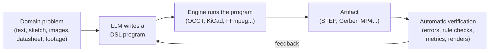

# Map to Software

> **Turn non-software problems into software problems, then let AI solve the software.**

Large Language Models (LLMs) keep getting better at writing code. On many programming tasks they already perform at the level of strong human engineers, and they keep improving. **Map to Software** starts from one working assumption:

> *Writing software is becoming a solved problem.*

If that holds, any problem that can be **expressed as code** can be handed to an AI that writes code. The question then changes from *"is there an AI for this domain?"* to *"what is the right language to express this domain as code?"*.

This repository answers that question, domain by domain: **which language to use, which engine turns the code into the real result, and which benchmark shows how well AI models handle it**. It covers physical domains (mechanical parts, circuit boards) and digital/creative ones (video editing).

---

## Domains

| Domain | Recommended DSL | Engine / output | Main benchmark | Guide |
|---|---|---|---|---|
| **Computer-Aided Design (CAD)** | CadQuery / build123d (Python) | OCCT → STEP, STL | BenchCAD | [computer-aided-design.md](domains/computer-aided-design.md) |
| **Printed Circuit Board (PCB) Design** | Zener (Starlark) | `pcb` + KiCad → Gerber | PCB Gym | [printed-circuit-board-design.md](domains/printed-circuit-board-design.md) |
| **Video Editing** | FFmpeg · Remotion · MLT / OpenTimelineIO (depends on the kind of video) | FFmpeg, Remotion or MLT renderer → MP4 | Timeline-Bench | [video-editing.md](domains/video-editing.md) |

Each guide explains the recommended tool and why, the alternatives and when to use them, and the benchmarks for that domain.

*OCCT = Open CASCADE Technology, the open-source geometry kernel. STEP / STL = standard 3D model formats. Gerber = the standard format for manufacturing circuit boards.*

---

## The idea

### Reduction: borrowing a concept from computer science

In computational complexity theory, a [**reduction**](https://en.wikipedia.org/wiki/Reduction_(complexity)) turns every instance of a problem **A** into an instance of a problem **B**. Once you have that, any solver for B also solves A.

Map to Software applies the same idea:

| | Complexity theory | Map to Software |
|---|---|---|
| **Problem A** | The problem we want to solve | A real-world task: design a bracket, lay out a circuit board, edit a video |
| **Problem B** | A problem we already know how to solve | Writing a program in a domain-specific language (DSL) |
| **Solver for B** | An existing algorithm | An LLM that writes code, plus tools that run and check it |
| **The reduction** | A transformation from A to B | Describing the task in the DSL: *"design this bracket"* becomes *"write the CadQuery program that builds this bracket"* |

The consequence is what makes the idea powerful: if the DSL can express the useful designs of a domain, and running the program produces the real result (a manufacturable part, a board ready for fabrication, a finished video), then **every improvement in AI coding carries over to that domain**. We do not need a separate "AI for CAD" or "AI for electronics". We need a good language for each domain and a good coding model.

### The bridge: Domain-Specific Languages (DSLs)

A [**Domain-Specific Language**](https://en.wikipedia.org/wiki/Domain-specific_language) is a programming language, or a library inside a general-purpose language, made for one field. In this project the DSL is what makes the reduction possible. A good DSL for this purpose is:

- **Text-based.** LLMs read and write text. A design stored as text can be generated, read, reviewed and edited by a model.
- **Executable and deterministic.** Running the same program always produces the same artifact (a 3D solid, a board layout, a video file).
- **Verifiable.** The output can be checked automatically: it runs without errors, passes design-rule checks, matches a reference, has the right dimensions.
- **Parametric.** Values are variables, not hard-coded numbers, so one program describes a whole family of designs (*"same bracket, but 5 mm thicker"*).
- **Version-controllable.** Designs live in Git, with diffs, reviews, branches and history, like any other code.

**Why not let the AI use the usual graphical tools?** An AI can also operate a GUI application (Fusion 360, KiCad's editor, Premiere) through screenshots and clicks, but that is slow, hard to check automatically and hard to review or repeat. A program is the opposite: it is fast to run, every change is visible in a diff, and the same program always gives the same result.

### The pipeline

1. **Describe** the problem: text, a sketch, reference images, a datasheet, raw footage.
2. **Generate** a program in the domain's DSL with an LLM.
3. **Execute** it with the domain's engine to get a real artifact.
4. **Verify** the artifact automatically. Errors and metrics go back to the model, which fixes the program and runs it again. This feedback loop is what makes coding agents work well, and it works the same way here.

Outside the loop, **benchmarks** measure how well each model performs in each domain, so you know which model to use and how much to trust it.

### How a tool is chosen

The recommended tool in each guide is the one that best meets these criteria:

1. **It is a mature, text-based DSL**, ideally in or close to a language LLMs already write well (Python, TypeScript).
2. **A reliable engine** turns the program into the real artifact, in a standard format other tools can open.
3. **Outputs can be checked automatically**, without a human in the loop for every iteration.
4. **A public benchmark** measures how well models use it.
5. **It is open and runs locally**, with no API limits that block an agent making hundreds of calls a day.

Not every tool meets all five. When two tools are close, the guide says when to choose each one.

---

## Other candidate domains

The same approach can be applied to many other fields. Possible future guides:

| Domain | Example DSLs | Artifact |
|---|---|---|
| Digital hardware (chips, FPGAs) | Verilog, VHDL, Chisel, Amaranth | Netlist, bitstream |
| Documents and typesetting | LaTeX, Typst, Markdown | PDF |
| Diagrams and vector graphics | SVG, TikZ, Mermaid, Graphviz | Images |
| Data visualization | Vega-Lite, matplotlib | Charts |
| Music notation | LilyPond, ABC notation, MusicXML | Sheet music, MIDI |
| Robotics | URDF, MJCF (MuJoCo) | Robot / simulation models |
| Infrastructure | Terraform, Kubernetes YAML | Cloud deployments |
| Architecture / buildings | IFC (via IfcOpenShell), Grasshopper/Python | BIM models |

---

## Limitations and open questions

- **The premise is a hypothesis.** "Software is solved" is a trend, not a proven fact. Models still make mistakes, especially on long, complex or new tasks.
- **The mapping is only as good as the DSL.** If a design cannot be expressed in the language, the model cannot produce it. A weak DSL caps what the model can achieve, no matter how good the model is.
- **Spatial reasoning is still hard.** CAD and PCB work need geometric and physical intuition (sizes, clearances, how parts fit together), which is weaker in current models than pure coding ability.
- **Verification is not the same as correctness.** A board can pass DRC and still not work. A part can match the reference geometry and still not be manufacturable. A video can render and still look bad. Automatic checks catch many errors, but not all.
- **Less training data.** There is far less public CadQuery, Zener or MLT code than Python or JavaScript, so models know these DSLs less well. Documentation in context (for example agent *skills*) helps a lot.
- **Benchmarks age fast.** Leaderboards change quickly and some benchmarks saturate. Always check the current leaderboard.
- **Humans stay in the loop.** For anything that gets manufactured or published, a human should review the result.

---

## Contributing

Contributions are welcome, especially:

- A new **domain guide** in `domains/`, following the same structure (recommended tool, alternatives, benchmarks).
- New **DSLs**, **tools** or **benchmarks** for existing domains.
- Corrections. If a link, description or claim is wrong or outdated, please open an issue or a pull request.
